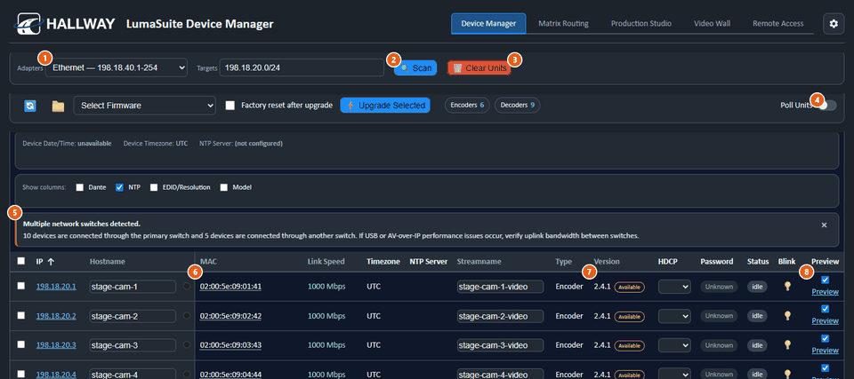
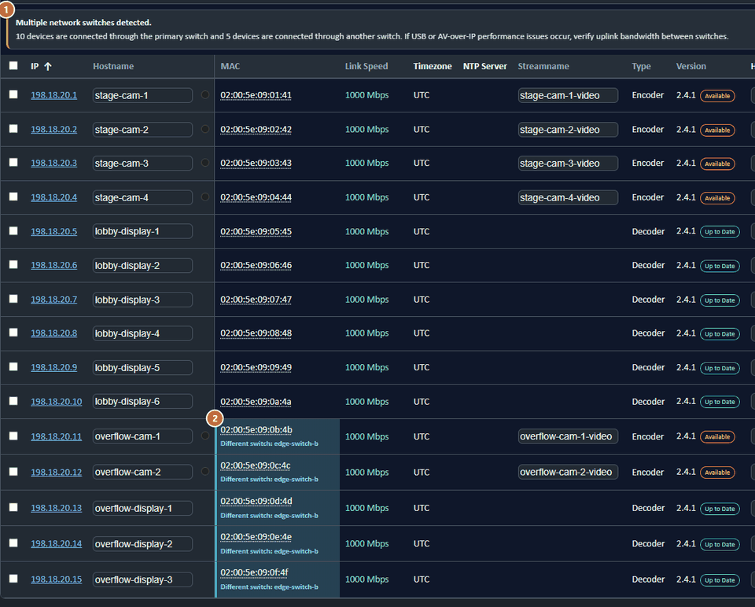
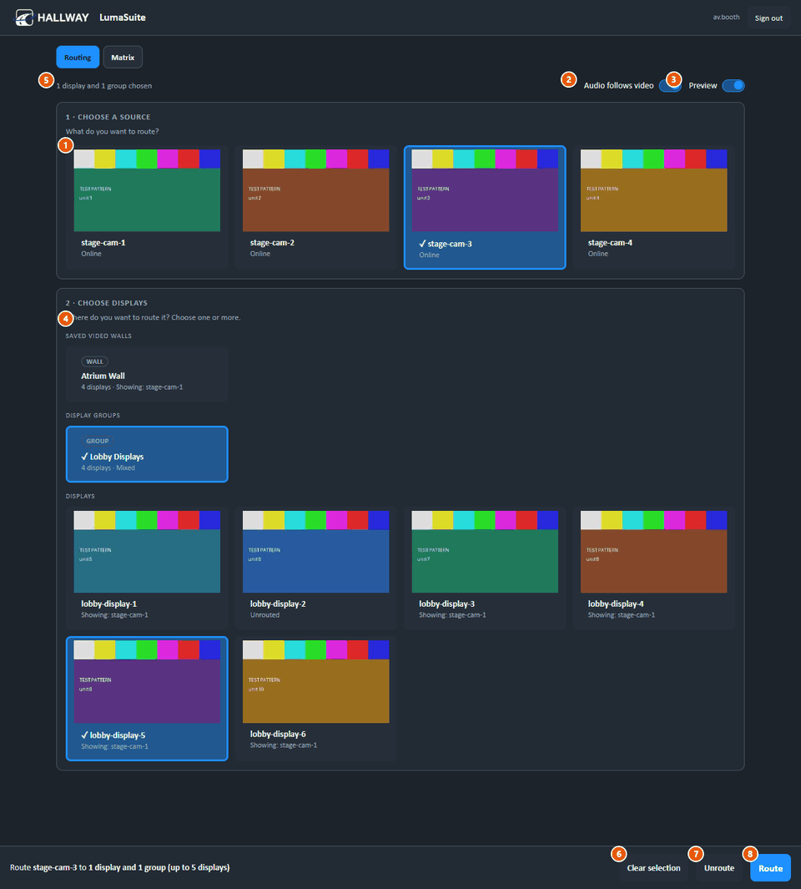
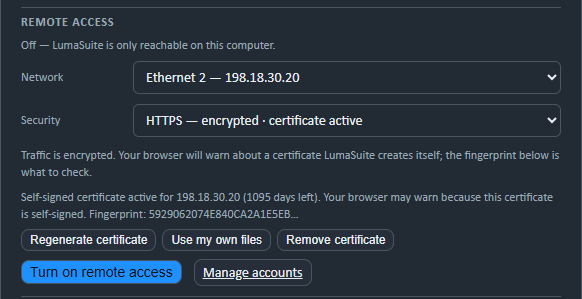

# LumaSuite

**Current Version: 1.1.1**

LumaSuite discovers, configures, routes and firmware-upgrades **LumaStream** HDMI-over-IP
encoders and decoders (`HW-LUMA-E****` / `HW-LUMA-D****`) and **Atlona AT-OME-CS31** HDMI matrix
switchers, and includes Production Studio (slates, logo overlay, ticker, RTMP). It is a Flask
application with a browser interface, run through a small launcher window and packaged as a
single application for Windows (x86-64) and macOS (Apple Silicon).

- [User Guide](ui/manual.html) (Settings > User Guide in the application) is what an operator reads.
- [RELEASE_NOTES.md](RELEASE_NOTES.md) and [CHANGELOG.md](CHANGELOG.md) say what changed.
- [BUILD_STANDALONE.md](BUILD_STANDALONE.md) says how to build it.
- [PROJECT.md](PROJECT.md) is the technical reference and [AGENTS.md](AGENTS.md) the rules for working on the code.
- [THIRD_PARTY_NOTICES.md](THIRD_PARTY_NOTICES.md) lists the components inside the application and their licences.

## What it does

- **Device Manager**: scan the adapter's network and any routed networks you list, track units by
  hardware (MAC) address so a changed address updates the unit instead of duplicating it, set
  hostnames, passwords, NTP and HDCP, see AV LAN link speed and the connected switch port, be told when
  units are plugged into more than one network switch, and upgrade firmware. Firmware availability is checked in the background at launch and every seven days (six hours after a failed attempt), has no off switch, and never installs anything.
- **Matrix Routing**: an administrator routes *Audio + Video*, *Video* or *Audio* from any source to
  any display. A route is only reported as done after the display itself confirms it.
- **Video Wall**: layouts, zones, per-decoder Video Wall Mode, and routing a source to a saved wall.
- **Production Studio**: output, input, RTMP, ticker, static image, and logo overlay (position, height
  and transparency are written to the unit as you change them).
- **Remote Access** (optional, off until an administrator turns it on): administrators open the normal
  pages from another device; Users get a simple page limited to the sources, displays, display groups and
  saved video walls they were assigned. See below.
- **Backup and Restore**: one encrypted file, made and restored on the LumaSuite computer only.

## Screenshots

The screenshots below, and those in the [User Guide](ui/manual.html), were taken from this version against simulated
units on example addresses (198.18.0.0/15); the units, names and addresses are not real equipment.



*Device Manager.* Scan the adapter's network and any routed networks you list; units are tracked by hardware address.



*Multiple-switch awareness.* Units on a switch other than the primary one are marked, with counts in the notice. Informational only.



*Standard routing for a User.* Choose a source and any number of displays, groups and saved walls, then press Route.



*Remote Access and certificates.* HTTP is the default; HTTPS needs a certificate, which LumaSuite creates only when asked.

## Supported platforms

Two platforms are distributed, and only those: **Windows x86-64** and **macOS on Apple Silicon (arm64)**.
There is no macOS Intel build, no universal binary and no Linux build; nothing is built, tested, named,
published or offered by the update check for them. The *test runner* (where the automated suites run in CI) and the
*distributed platform* (what a release carries) are the same two machines, and the workflow asserts that.

| Platform | Archive | Built and tested on | Status |
|---|---|---|---|
| Windows x86-64 | `LumaSuite-<tag>-windows-x86_64.zip` (single `LumaSuite.exe`) | `windows-latest` | Built; the packaged application has been started and exercised on Windows 11. The executable is not Authenticode-signed (Windows SmartScreen asks you to confirm). |
| macOS Apple Silicon (arm64) | `LumaSuite-<tag>-macos-arm64.zip` (`LumaSuite.app`) | `macos-15` (a native arm64 runner) | Built by the release workflow, which checks the Mach-O architecture of every file. **Not yet run on a Mac by Hall Research.** |

The macOS app carries an ad hoc signature only (the build signs it again after the version is stamped into
`Info.plist`, because Apple Silicon will not run code whose signature does not verify). It is not Developer ID
signed and not notarised, so Gatekeeper asks you to confirm the first time (right-click, Open). The minimum macOS
version has not been established. Windows on Arm, 32-bit systems, Intel Macs and Linux are not provided. A
computer of an unsupported kind that checks for updates is told there is no supported update package for it.

## Run from source

Python 3.12 is what the lock and CI use.

```bash
pip install -r requirements-build-lock.txt   # exact pins; requirements-build.txt lists the direct ones
python app_launcher.py                       # launcher window and system tray (the normal way)
python lumaserver.py                         # server only
```

### Local port

The launcher starts the local interface on `http://127.0.0.1:8090` and, if that port is busy, takes the
next free one, showing the real address in its window. This is automatic and needs no setting.

- **Settings > Local Application Port > Use a fixed TCP port** keeps the address the same. *Save and
  Restart* really restarts LumaSuite: the old instance releases the port first. Unchecking returns to
  automatic selection.
- A busy fixed port is never silently replaced. The launcher stays open with **Retry**, **Start on
  Alternate Port** (this session only; the saved port is not changed), **Change Fixed Port** and **Exit**.
- The setting is stored in `local_port.json` in the application data folder and is not part of a Backup.
  A missing or damaged file falls back to automatic selection; nothing can stop LumaSuite starting.
- `--port=N` overrides for one run and is never saved. `python lumaserver.py` (no launcher) starts at
  `LUMA_PORT` (default 8089), drifts to a free port, and has no Settings port block.
- The local listener binds loopback only. `LUMA_HOST` names another address if you need one; a listener
  not on loopback is treated as a network listener and gated like Remote Access.

Runtime data lives in the application data folder (`%LOCALAPPDATA%\LumaSuite` on Windows,
`~/Library/Application Support/LumaSuite` on macOS, `~/.lumasuite` on Linux), or in `LUMA_DATA_DIR`.
It is never written beside the executable.

## Remote Access

Optional and off by default; LumaSuite on its own computer is unchanged either way.

- **Accounts**: Administrator and User, scrypt password hashing, throttled sign-in, server-side sessions,
  CSRF protection, optional Direct Access links (never for an administrator), and a plain-language
  activity log (30 days and 4 MB by default).
- **Permissions** are by hardware address over sources, displays, display groups and saved video walls.
  Each User is given *Standard routing* (cards and drag and drop), *Matrix routing*, or both.
- **HTTP or HTTPS.** Settings starts on **HTTP**, labelled *not encrypted*, because a certificate is valid
  only for the address it was made for and a DHCP address can change. HTTPS is one choice away and there
  is no automatic fallback from HTTPS to HTTP; plain HTTP always needs an explicit acknowledgement.
- **Certificate wording.** *Certificate active* means LumaSuite can serve HTTPS with the certificate it
  generated; *custom certificate active* is one you supplied; *certificate required* means it is missing,
  unreadable, expired or made for another network. *Active* never means a browser trusts it: a
  certificate LumaSuite makes is self-signed and the first visit warns.
- **Generated certificate.** Issued to the Windows machine name (CN), organisation Hall Research, unit
  LumaSuite; subject alternative names are the machine name (DNS) and the chosen adapter's address (IP);
  valid three calendar years. Existing certificates are never replaced automatically. **Regenerate
  certificate** is explicit, asks first and reports the old and new fingerprints. A supplied certificate
  is never replaced by it. Use *Use my own files* for a name your DNS resolves everywhere.
- **Display Groups**: one Route sends a source to every display in the group together (a small bounded
  parallel batch), each confirmed on its own, and a group only ever changes its own members (each member is
  identity-confirmed by hardware address before it is written). The User page remembers ticked targets, so
  choosing a second group after routing the first routes both; the Route button says how many.
- **Saved Video Walls** can be assigned to a User as one destination; members are identity-confirmed
  before any write.
- **Audio follows video** (Standard routing, on by default, not stored): off means a route changes the
  picture only.
- **Restore** is authoritative for what the backup managed, and signs out anyone whose account changed. It
  is transactional: the configuration files are snapshotted first and every one is put back if any write fails
  (a file the restore created is removed); a rollback that cannot complete says so and refuses further
  changes until restart. The device details a backup remembers are merged into the live inventory in one
  critical section, so a scan or poll running at the same time is never overwritten and a removed unit is
  never brought back; if the inventory cannot be saved the response says so (`devices.saved: false` and a
  warning) and the merge is taken back out of memory.

## Build

```bash
python build_executable.py windows   # dist/Windows/LumaSuite.exe
python build_executable.py macos     # dist/macOS/LumaSuite.app (Apple Silicon only; an Intel Mac refuses)
```

Each target is built on its own operating system, normally by `.github/workflows/build-cross-platform.yml`.
The build installs from `requirements-build-lock.txt`, packages the `ui/` folder, the licence texts and the
third-party notices, and never packages a firmware folder or credentials. See
[BUILD_STANDALONE.md](BUILD_STANDALONE.md).

## Tests

```bash
python run_tests.py        # every suite, one process each, totalled
```

Python suites live in `tests/test_*.py` and run against a hardware fence (no non-loopback socket can be
opened) with a scratch data folder; Node suites are `tests/*_test.js` and `tests/*.test.js`. CI runs all
of them before it builds anything.

## Known limitations

- Inventory size: LumaSuite is qualified for up to about 250 units. Inventories of 500 and 1,000 simulated units were
  also run; they work, but background refresh rounds are long and the Matrix Routing page opens slowly (a few seconds
  at 1,000). Beyond 32 units the Device Manager's background detail refresh reads in batches of at most 32. These counts
  were measured with simulated units, mostly silent, not with that many physical units.
- `GET /api/remote_access` (the Settings Remote Access block) performs a network-adapter lookup and can
  take a few seconds, longest on first use. Other pages do not wait for it.
- There is no single-instance lock. Starting LumaSuite twice runs two servers (the second takes the next
  free port, or reports a busy fixed port); two instances share one data folder and should not be left
  running together.
- Under sustained use the server's memory rises slowly (about 2 MB per hour measured over a six-hour
  instrumented run, most of it the bounded activity log, and flat when idle). It has not been shown to be
  a leak or shown not to be one; restart a LumaSuite that has run for days.
- LumaSuite makes two kinds of outbound HTTPS request, and neither has an off switch. In the background at
  launch, every seven days, and six hours after a failed attempt (and on *Check Now*), it asks Hall Research
  for published firmware versions (the library's standard User-Agent). Opening Settings or pressing *Check Now*
  asks GitHub for the newest LumaSuite release (User-Agent `LumaSuite/<version>`). Each server can see the
  computer's public address; nothing about your devices or network is sent, and neither check ever downloads
  or installs anything, including LumaSuite. With no Internet the last answer is kept and nothing else is affected.
- The generated Remote Access private key is written owner-only where the system supports permission bits; on Windows it
  inherits the data folder's access list. It is never returned, logged or packaged; keep the data folder private.
- A remote administrator can use the device-changing pages (routing, hostnames, HDCP, NTP, reset, firmware, scan, saving
  walls) on devices LumaSuite already knows; Users cannot.
- A restricted User's verified route to a saved Video Wall updates that wall's saved source to what the displays now show.
  Whether that should be allowed is a product decision that has not been made.
- The network listener answers only to the Remote Access address, this computer's name, `localhost` and names in a
  supplied certificate; a page opened by any other name is refused (421).
- Remote Access over plain HTTP sends passwords and routing commands unencrypted; use it only on a network
  you trust.
- Some behaviour depends on the equipment and is reported rather than changed, for example whether a
  display's audio follows video, and the encoder preview source (`LUMA_ENCODER_PREVIEW`) has not been
  verified on hardware.

## Licence

LumaSuite is source-available software under the Hall Research Technologies Source-Available Software License
(version 1.0), in [LICENSE](LICENSE): free to use, including in business; selling it and distributing modified
versions are not permitted. Section 11A preserves the rights the GNU LGPL gives you for the LGPL-licensed library
pystray 0.19.5, whose unmodified source ships in [third_party/pystray-0.19.5/](third_party/pystray-0.19.5/); see
[REBUILD.md](REBUILD.md) to rebuild LumaSuite with a modified copy. The third-party components that ship inside the
application, with their licences, are in [THIRD_PARTY_NOTICES.md](THIRD_PARTY_NOTICES.md) and in `licenses/`; the same
texts are served by the application at **Settings > About > License**.

Copyright (c) 2026 Hall Research Technologies LLC.
